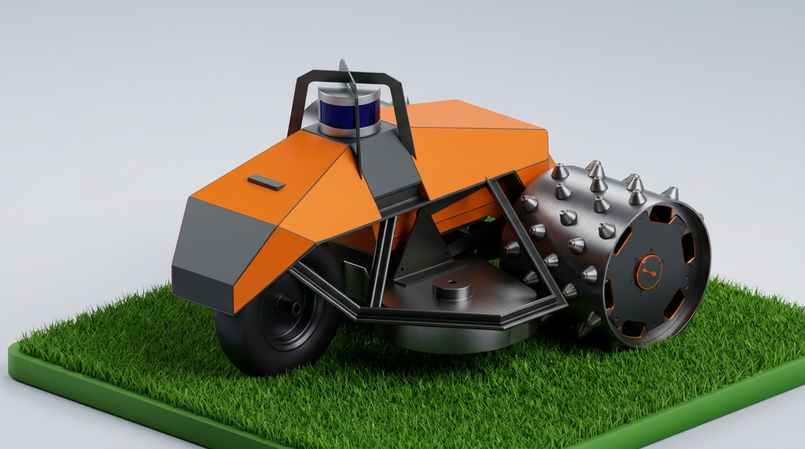
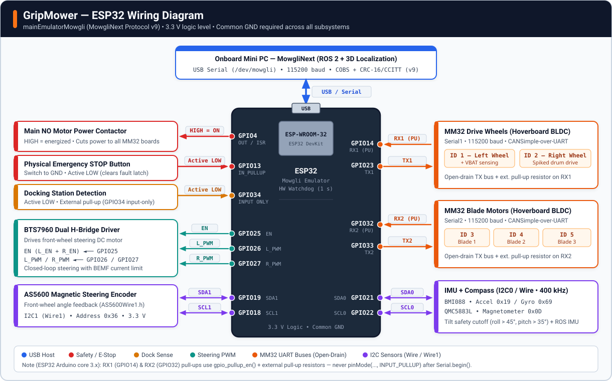

# GripMower



Hardware and firmware repository for **GripMower**, a custom **autonomous robotic lawn mower built for steep slopes**.

GripMower runs on an onboard **Mini PC** powered by [MowgliNext](https://github.com/mowglinext/mowglinext) with a **3D localization extension** ([`lukaskrnac/mowglinext` (`3D_slam`)](https://github.com/lukaskrnac/mowglinext/tree/3D_slam)). The spiked traction drive wheels use **hoverboard BLDC hub motors**, and the cutting deck uses **3× 6374 BLDC motors** — all driven by MM32 motor controllers running [Hoverboard-Firmware-Hack-Gen2.X-MM32](https://github.com/lukaskrnac/Hoverboard-Firmware-Hack-Gen2.X-MM32).

This repository hosts the low-level **ESP32 firmware** (emulating the Mowgli STM32 mainboard over wire protocol **v9**), MM32 CANSimple-over-UART motor communication, IMU/magnetometer sensing, active front-wheel steering, safety watchdog logic, and automated firmware build/flashing tools.

## Repository Structure

```text
GripMower/
├── .github/
│   └── workflows/
│       └── build-esp32-firmware.yml  # Automated ESP32 firmware build + GitHub Release
├── firmware/
│   └── esp32/
│       └── mainEmulatorMowgli/   # Arduino sketch for ESP32 (MowgliNext protocol v9)
│           ├── mainEmulatorMowgli.ino
│           ├── Mm32Motors.h      # MM32 control & telemetry (drive wheels + blades)
│           ├── Mm32Uart.h        # CANSimple-over-UART framing + CRC16-XMODEM
│           ├── MotorWatchdog.h   # Hardware watchdog + immediate contactor cutoff in ISR
│           ├── imu.h / imu.cpp   # BMI088 (accel/gyro) + QMC5883L (magnetometer)
│           └── AS5600Wire1.h / AS5600.cpp  # Magnetic steering encoder (Wire1)
├── tools/
│   ├── flash-esp32.sh            # Downloads latest GitHub release & flashes ESP32 over USB
│   └── install-flasher.sh        # Installs CLI & Desktop icon on the onboard Mini PC
├── docs/
│   └── images/
│       ├── gripmower.jpg         # GripMower render
│       └── esp32-wiring.svg      # ESP32 wiring schematic
└── hardware/                     # (reserved for schematics, PCB, CAD/3D models)
```

## Hardware & ESP32 Pinout



| Function | ESP32 Pin(s) | Notes |
|---|---|---|
| Host communication (Mini PC / MowgliNext) | `Serial` (USB) | 115200 baud, COBS + CRC-16/CCITT, protocol v9 |
| MM32 drive wheels (ID 1 left, ID 2 right) | `Serial1`: RX `GPIO14`, TX `GPIO23` | 115200 baud, open-drain bus with pull-up resistor |
| MM32 blade motors (ID 3, 4, 5) | `Serial2`: RX `GPIO32`, TX `GPIO33` | 115200 baud, open-drain bus with pull-up resistor |
| Main NO motor power contactor | `GPIO4` | `HIGH` = energized, also cut immediately in watchdog ISR |
| Physical emergency STOP button | `GPIO13` | `INPUT_PULLUP`, active `LOW` |
| Docking station detection | `GPIO34` | Active `LOW` |
| IMU (BMI088 + QMC5883L) | `Wire` (I2C0) | 400 kHz (`0x19`, `0x69`, `0x0D`) |
| Front-wheel steering encoder (AS5600) | `Wire1`: SDA `GPIO19`, SCL `GPIO18` | Modified `AS5600Wire1.h` library |
| Steering servo motor driver (BTS7960) | `GPIO25`, `GPIO26`, `GPIO27` | EN, L_PWM, R_PWM |

> **ESP32 Arduino core 3.x note:** Never call `pinMode(rxPin, INPUT_PULLUP)` after `Serial1.begin()` / `Serial2.begin()` (it disconnects RX from the UART peripheral). The firmware uses `gpio_pullup_en()` together with an external pull-up resistor.

## Drive System & Safety

- **BLDC motors & MM32 controllers:** 2× MM32 controllers for the hoverboard BLDC drive wheels (IDs `1`, `2`) + 3× MM32 controllers for the 6374 BLDC cutting blade motors (IDs `3`, `4`, `5`), all running [Hoverboard-Firmware-Hack-Gen2.X-MM32](https://github.com/lukaskrnac/Hoverboard-Firmware-Hack-Gen2.X-MM32).
- **Kinematics:** `WHEEL_DIST = 0.52 m`, `STEER_DIST = 0.52 m`, `WHEEL_DIAMETER_M = 0.29 m`, gear ratio `WHEEL_GEAR_RATIO = 9.7`.
- **Active slope hold brake (`WHEEL_HOLD_BRAKE = 1`):** Drive wheels remain armed in `MM32_RUN` at `0 rev/s` when stationary (including on `tilt_latch` on steep slopes while blades drop to `IDLE`). Pressing the physical STOP button, losing host heartbeat (> 500 ms), any motor controller fault, or a watchdog trip immediately drops the main contactor on `GPIO4`.
- **No-blade bench testing:** Blade readiness checks in `checkMotorPower()` are currently commented out for testing without blade boards — uncomment them once the blade controllers are connected.

## Automated Builds (GitHub Actions)

Every push to `main` (or manual run via **Actions → Build ESP32 Firmware**) automatically compiles `mainEmulatorMowgli.ino` using `arduino-cli` (`esp32:esp32:esp32`, ESP32 core `3.3.13`) and publishes `gripmower-esp32-merged.bin` (along with `SHA256SUMS.txt` and `firmware-info.json`) to the rolling GitHub Release tagged **`firmware-latest`**.

Pushing a version tag (e.g. `v0.9.3`) also creates a permanent archived GitHub Release for that version.

## Flashing Firmware on the Mower (Mini PC via USB)

### 1. One-time Desktop icon setup (for Remote Desktop)

Open a terminal on the onboard Mini PC and run:

```bash
curl -fsSL https://raw.githubusercontent.com/lukaskrnac/GripMower/main/tools/install-flasher.sh | bash
```

This installs `~/.local/bin/gripmower-flash-esp32` and creates a **GripMower ESP32 Flash** shortcut on the Desktop and in the Applications menu.

### 2. Updating the ESP32 anytime via Remote Desktop

1. Make sure the mower is stationary and the blades are safely stopped (ideally engage the physical STOP button).
2. Double-click **GripMower ESP32 Flash** on the Desktop (or run `~/.local/bin/gripmower-flash-esp32` from a terminal).
3. The script automatically:
   - fetches the latest build info from the `firmware-latest` GitHub Release and compares it with the last flashed version,
   - auto-detects the ESP32 USB serial port (preferring `/dev/mowgli` and excluding `/dev/gps` and `/dev/lidar`),
   - downloads `gripmower-esp32-merged.bin` and verifies its SHA-256 checksum,
   - installs `esptool` into an isolated Python venv (`~/.local/share/gripmower-flasher/venv`) on first run if missing,
   - temporarily stops the `mowgli-ros2` Docker container, flashes the ESP32 at `0x0` (automatically retrying at `115200` baud if needed), and starts `mowgli-ros2` back up.

Useful CLI options:

```bash
~/.local/bin/gripmower-flash-esp32 --port /dev/ttyUSB0     # specify serial port manually
~/.local/bin/gripmower-flash-esp32 --tag v0.9.3            # flash a specific release tag
~/.local/bin/gripmower-flash-esp32 --self-update           # update the flasher script itself
```

## Manual Compilation (Arduino IDE)

1. Open `firmware/esp32/mainEmulatorMowgli/mainEmulatorMowgli.ino` in Arduino IDE (board: **ESP32 Dev Module**, ESP32 core **3.x**).
2. Install the required libraries:
   - `FastCRC`
   - `PacketSerial`
   - `BTS7960`
   - `Bolder Flight Systems BMI088` (`BMI088.h`) — *note: on ESP32 Arduino core, add `#undef OPEN_DRAIN` right after `#include "Arduino.h"` in `BMI088.h` to avoid colliding with ESP32's GPIO `OPEN_DRAIN` macro*
   - `FastIMU` (used for `QMC5883L`)
3. Compile and upload to the ESP32.
